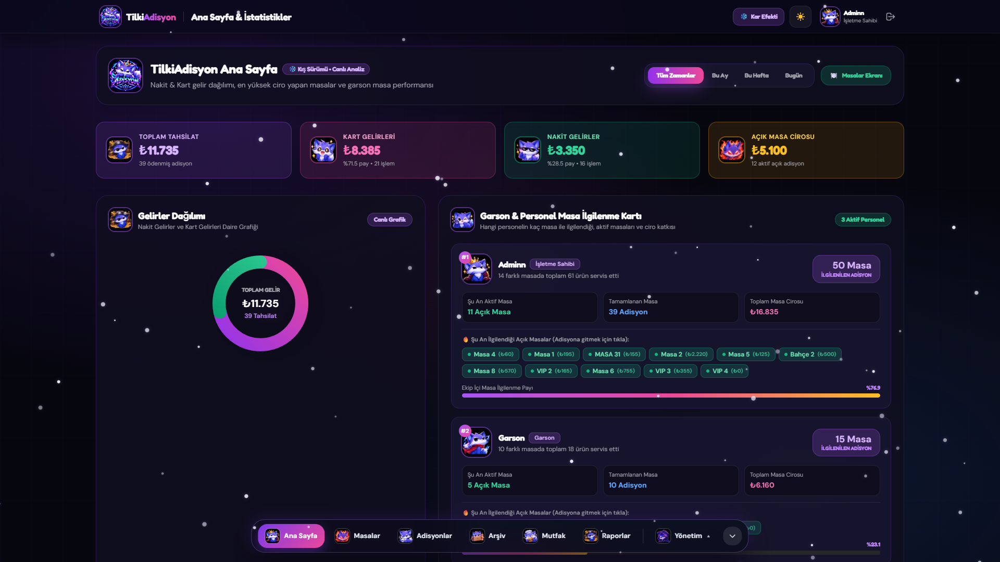
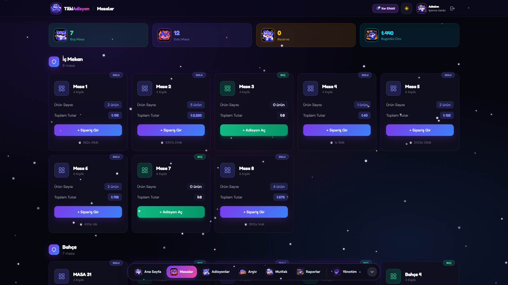
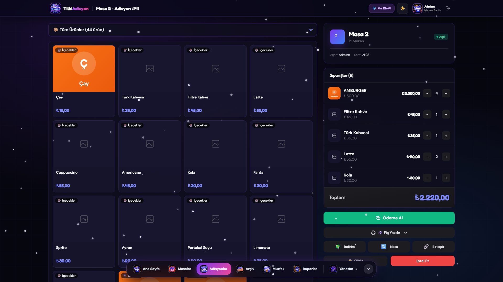
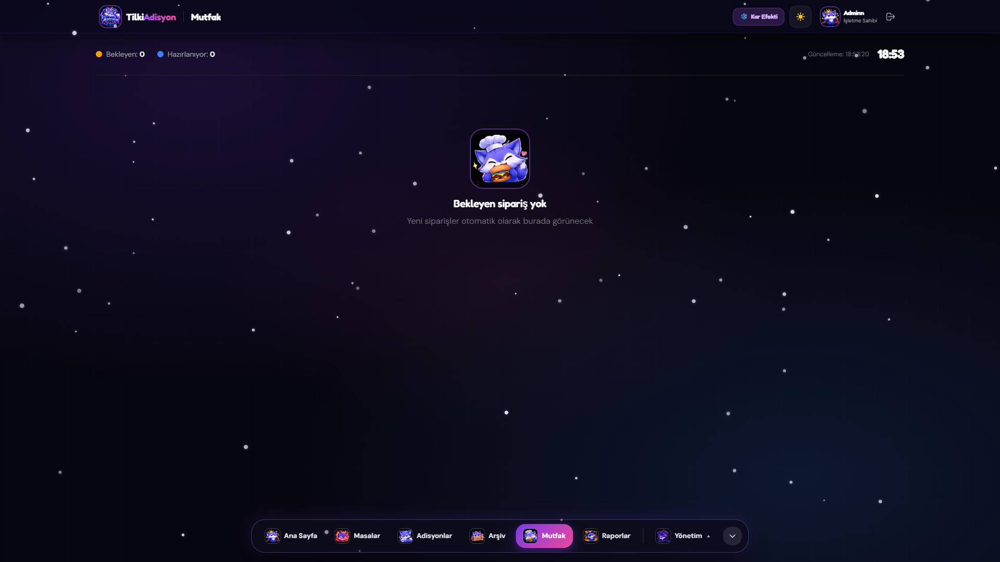
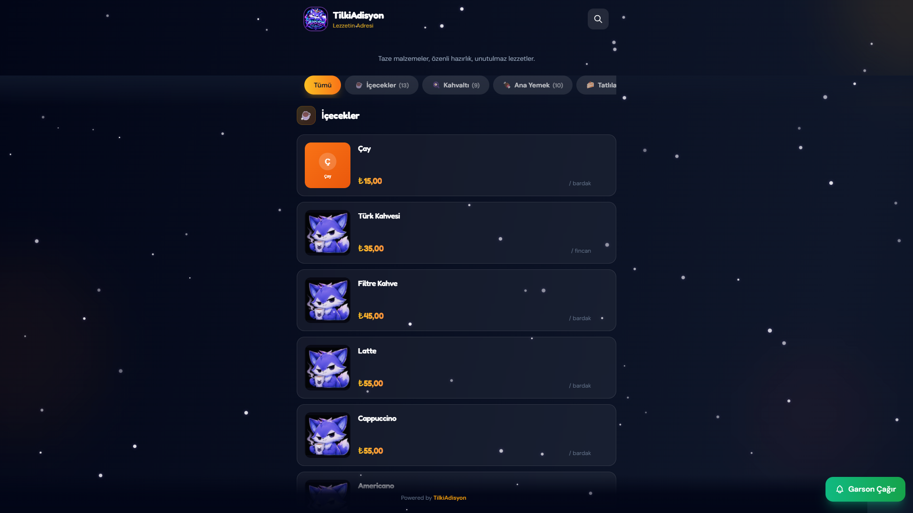
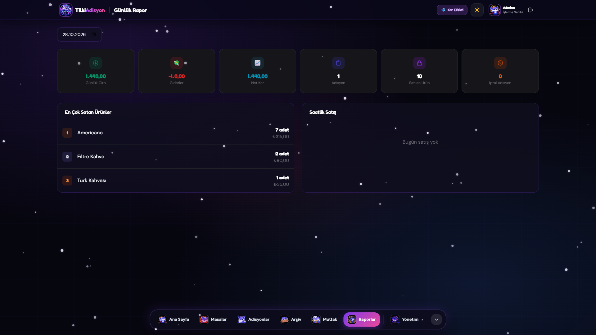
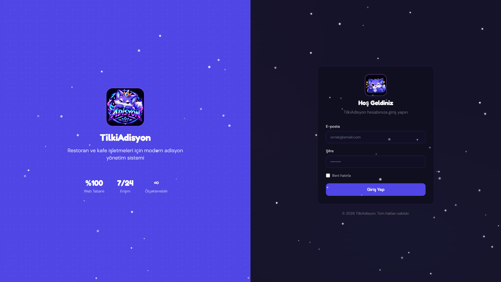

<div align="center">


# 🦊 TilkiAdisyon

### Yeni Nesil Kozmik Restoran, Kafe & Adisyon POS Otomasyonu

[-10b981?style=for-the-badge&logo=nodedotjs&logoColor=white)](https://nodejs.org/)
[](https://react.dev/)
[](#)
[](#)

**TilkiAdisyon**; restoran, kafe, lounge ve sosyal tesislerin masa takibi, hızlı sipariş, parçalı tahsilat, canlı mutfak ekranı (KDS), temassız QR menü ve detaylı ciro/personel analitiği ihtiyaçlarını **sıfır harici bağımlılıkla** tek bir ultra-hızlı ekosistemde birleştiren tam kapsamlı (full-stack) açık kaynaklı POS yazılımıdır.

[🚀 Tek Tıkla Çalıştır](#-hızlı-başlangıç-tek-tıkla-çalıştır) • [🌐 Otomatik Domain Bağlama (`KURULUM.md`)](KURULUM.md) • [✨ Özellikler](#-öne-çıkan-özellikler) • [📸 Ekran Görüntüleri](#-ekran-görüntüleri)

</div>

---

## 📸 Ekran Görüntüleri

<div align="center">
  
  <p><i><b>Ana Sayfa (`/anasayfa`):</b> Canlı Nakit & Kart Gelirleri Daire Grafiği, Garson Masa İlgilenme Kartı ve En Yüksek Ciro Yapan Masalar Sıralaması</i></p>
</div>

<br/>

| 🍽️ Canlı Masa Haritası (`/dashboard`) | ⚡ Hızlı Adisyon & Tahsilat (`/bills/:id`) |
| :---: | :---: |
|  |  |
| **👨‍🍳 Canlı Mutfak Ekranı - KDS (`/kitchen`)** | **📱 Dijital QR Menü & Çağrı (`/qr`)** |
|  |  |
| **📈 Günlük Z Raporu & Analiz (`/reports/daily`)** | **🔐 Kozmik Giriş Ekranı (`/login`)** |
|  |  |

---

## 🚀 Hızlı Başlangıç (Tek Tıkla Çalıştır)

Projeyi indirdikten sonra terminal komutlarıyla uğraşmadan doğrudan hazır `.bat` araçlarıyla kullanabilirsiniz:

### 1️⃣ Tek Tıkla Başlatma (`CALISTIR.bat`)
Proje klasöründeki **`CALISTIR.bat`** dosyasına çift tıklayın:
- Varsayılan `config.json` dosyasını otomatik kontrol eder.
- Kasa adresini (`http://localhost:3001/anasayfa`) ve yerel Wi-Fi garson/tablet IP adresini ekranda gösterir.
- Tarayıcınızı otomatik olarak açar ve sunucuyu başlatır.

### 2️⃣ Otomatik Kurulum & Domain Bağlama Sihirbazı (`KURULUM-VE-DOMAIN.bat`)
Kendi domaininizi bağlamak, port değiştirmek veya otomatik config dosyaları oluşturmak için **`KURULUM-VE-DOMAIN.bat`** dosyasına çift tıklayın:
- **`[1]` Otomatik Config Oluştur:** İşletme adınızı, port numaranızı ve özel domaininizi sorarak `config.json`, `domain-configs/nginx-adisyon.conf`, `domain-configs/cloudflare-tunnel.yml` ve `DOMAIN-YAYINLA.bat` dosyalarını **otomatik üretir**.
- **`[2]` Cloudflare ile Kendi Domainini Bağla:** Modemde port açmadan ücretsiz SSL ile kendi domaininizi (`https://adisyon.siteniz.com`) otomatik bağlar.
- **`[3]` Ücretsiz Anlık HTTPS Linki Al:** Domaininiz olmasa bile saniyeler içinde dış ağdan erişilebilir ücretsiz HTTPS adresi üretir.
- **`[4]` Yerel Wi-Fi Güvenlik Duvarı İzni:** Garson telefonları ve mutfak tabletlerinin bağlanabilmesi için Windows Firewall iznini otomatik açar.
- **`[5]` Veritabanını Sıfırla:** Tek tuşla fabrika ayarlarına ve örnek demo verilerine döner.

### 💻 Terminal Üzerinden Çalıştırma (Windows / Linux / macOS)
```bash
git clone https://github.com/KULLANICI_ADINIZ/tilki-adisyon.git
cd tilki-adisyon
npm start
```

| Hesap Türü | E-Posta | Şifre |
| :--- | :--- | :--- |
| **Yönetici (Admin)** | `admin@tilkiadisyon.com` | `admin` |
| **Garson** | `garson@tilkiadisyon.com` | `admin` |
| **Kasiyer** | `kasiyer@tilkiadisyon.com` | `admin` |

---

## ✨ Öne Çıkan Özellikler

### 📊 1. Ana Sayfa & Canlı Analitik Kokpiti (`/anasayfa`)
- **Nakit & Kart Gelirleri Daire Grafiği (SVG Donut Chart):** Toplam tahsilatı, kredi kartı ve nakit gelir oranlarını (`%` ve `₺`), işlem adetlerini ve parçalı ödeme kırılımlarını canlı olarak görselleştirir.
- **En Yüksek Ciro Yapan Masalar Sıralaması:** İşletmede en çok gelir üreten masaları madalya sıralaması (`👑 #1`, `🥈 #2`, `🥉 #3`), bölge bilgisi, adisyon sayısı ve ortalama sepet tutarıyla listeler; açık masalara tek tıkla geçiş sağlar.
- **Garson & Personel Masa İlgilenme Kartı:** Hangi garsonun kaç masa ile ilgilendiğini, şu an açık olan aktif masalarını (tıklanabilir adisyon rozetleriyle), tamamladığı adisyonları ve ekip içi performans payını canlı gösterir.
- **Dönemsel Filtreleme:** *Tüm Zamanlar*, *Bu Ay*, *Bu Hafta* ve *Bugün* filtreleriyle sayfa yenilenmeden anlık analiz.

### 🍽️ 2. Gerçek Zamanlı Masa & Bölge Haritası (`/dashboard`)
- **Çoklu Bölge Desteği:** *İç Mekan*, *Bahçe*, *Teras* ve *VIP Odalar* gibi sınırsız bölge tanımlama ve sıralama.
- **Canlı Masa Durumları:** Boş, Dolu ve Rezerve masaları renk kodlarıyla takip etme; açık masalarda geçen süreyi (dakika/saat) ve güncel adisyon tutarını kart üzerinde görme.

### ⚡ 3. Işık Hızında Adisyon, Sipariş & Tahsilat (`/bills/:id`)
- **Hızlı Ürün & Kategori Seçimi:** 30 özel **TilkiAdisyon** maskot çıkartması ve kategori filtreleriyle tek dokunuşta sipariş ekleme, adet artırma/azaltma ve ürün notu girme.
- **Gelişmiş Tahsilat Motoru:**
  - Tam Nakit veya Tam Kredi Kartı ile tek tuşla ödeme
  - **Parçalı Ödeme (Split Payment):** Hesabın bir kısmını nakit, kalanını kartla veya kişi bazlı ürün seçerek tahsil etme
  - Yüzdesel (`%`) veya tutarsal (`₺`) **İndirim** ve **İkram** tanımlama
- **Masa Taşıma & Birleştirme:** Açık adisyonu başka bir boş masaya aktarma veya iki farklı masanın adisyonunu tek masada birleştirme.
- **Termal Fiş Yazdırma:** Mutfak sipariş fişi ve müşteri adisyon bilgi fişi için hazır termal yazıcı (`80mm`) şablonu.

### 👨‍🍳 4. Sıfır Gecikmeli Canlı Mutfak Ekranı — KDS (`/kitchen`)
- Garsonun girdiği sipariş salisesinde sesli uyarı ziliyle mutfak ekranına düşer.
- *Bekliyor*, *Hazırlanıyor* ve *Hazır* durum geçişleri, gecikme süresi uyarıları ve masa/ürün bazlı onaylama.

### 📱 5. Masa Bazlı Temassız QR Menü & Garson Çağrı (`/qr`)
- Her masa için otomatik üretilen özel QR kodlar ve yazdırılabilir masa kartları.
- Müşteriler QR kodu okutarak güncel fiyatlı menüyü inceler ve tek tuşla **Garson Çağrı** bildirimi gönderir.

### 🎨 6. Apple HIG + Kozmik UI Deneyimi
- **Açılır/Kapanır Yüzen Alt Dock (Floating Bottom Dock):** Ekran alanını maksimuma çıkaran, cam efektli (glassmorphism) alt navigasyon barı ve **Yönetim ▴** hızlı çekmecesi.
- **Blur Sayfa Geçişleri:** Sayfalar arası geçişlerde sinematik motion-blur animasyonu.
- **Çift Tema (Dark & Light Mode) + ❄️ Kış Kar Efekti:** Tek tuşla gece/gündüz modu geçişi ve 60 FPS kış kar yağışı atmosferi.

---

## 🌐 Kendi Domaininizi Bağlama ve Sunucu Kurulumu

Projeyi **`KURULUM-VE-DOMAIN.bat` Otomatik Sihirbazı**, **Cloudflare Tunnel (port açmadan ücretsiz özel domain)**, **VPS + Nginx + Let's Encrypt SSL + PM2** veya **yerel Wi-Fi ağı** üzerinden nasıl yayınlayacağınızı adım adım öğrenmek için detaylı kurulum kılavuzuna göz atın:

👉 **[📘 KURULUM VE DOMAİN BAĞLAMA REHBERİ (`KURULUM.md`)](KURULUM.md)**

---

## 🗂️ Proje Dizin Yapısı

```text
tilki-adisyon/
├── CALISTIR.bat                # Tek tıkla sunucu ve tarayıcı başlatıcı (.bat)
├── KURULUM-VE-DOMAIN.bat       # Otomatik config.json ve domain bağlama sihirbazı (.bat)
├── config.json                 # İşletme adı, port ve özel domain yapılandırma dosyası
├── server.mjs                  # Ana HTTP + Inertia.js + REST API sunucusu
├── server/
│   ├── db.mjs                  # Native node:sqlite veritabanı şeması ve yardımcıları
│   ├── guard.mjs               # SHA-256 değiştirilemezlik ve otomatik .bat onarım koruması
│   ├── launcher.mjs            # AES-256-GCM şifreli sunucu ve tünel başlatıcı motoru
│   ├── seed.mjs                # Otomatik başlangıç verileri (4 bölge, 16 masa, 17 ürün, 5 örnek adisyon)
│   ├── setup-wizard.mjs        # AES-256-GCM şifreli interaktif kurulum ve domain config sihirbazı
│   └── ziggy.mjs               # İstemci tarafı isimlendirilmiş rota (route) tablosu
├── public/
│   ├── build/assets/           # React + Inertia sayfa bileşenleri (Home-Tilki.js vb.)
│   ├── images/                 # TilkiAdisyon logosu, 30 özel maskot emojisi ve ekran görüntüleri
│   └── tanitim.html            # Kozmik ürün tanıtım ve ön kayıt karşılama sayfası
├── KURULUM.md                  # Kendi domainini bağlama ve sunucu kurulum kılavuzu
└── README.md                   # Proje dokümantasyonu
```

---

## 👨‍💻 Geliştiriciler (Developers)

Bu proje özenle tasarlanmış ve geliştirilmiştir:

- 🦊 **[doga.dev](https://doga.dev)**
- 🔥 **[ensxr.dev](https://ensxr.dev)**

---

<div align="center">
  <sub>© 2026 <b>TilkiAdisyon</b> • Açık Kaynak Restoran & Kafe POS Otomasyonu. Yıldız (⭐) bırakmayı unutmayın!</sub>
</div>
